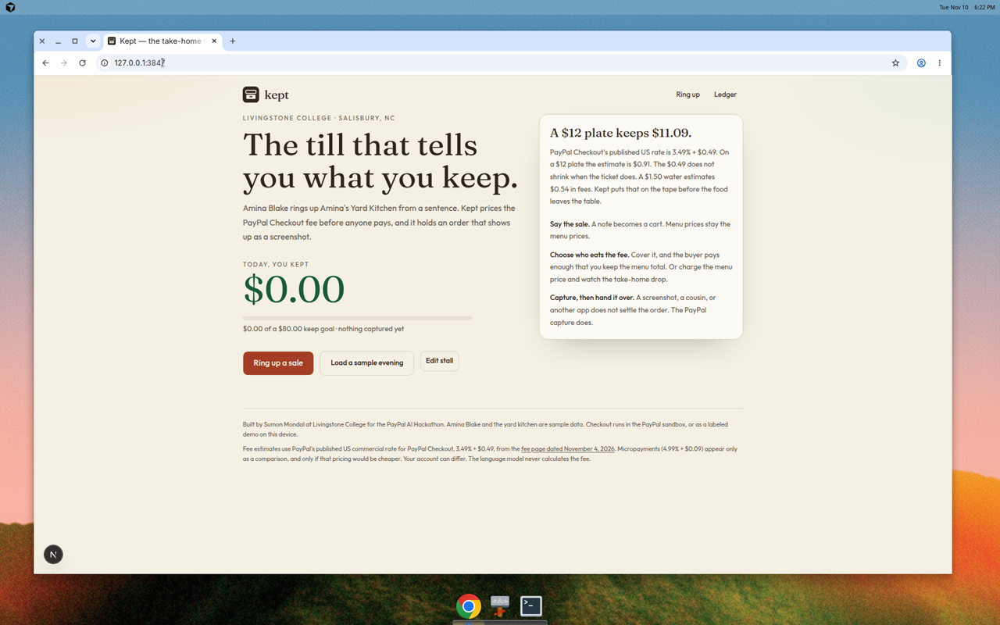
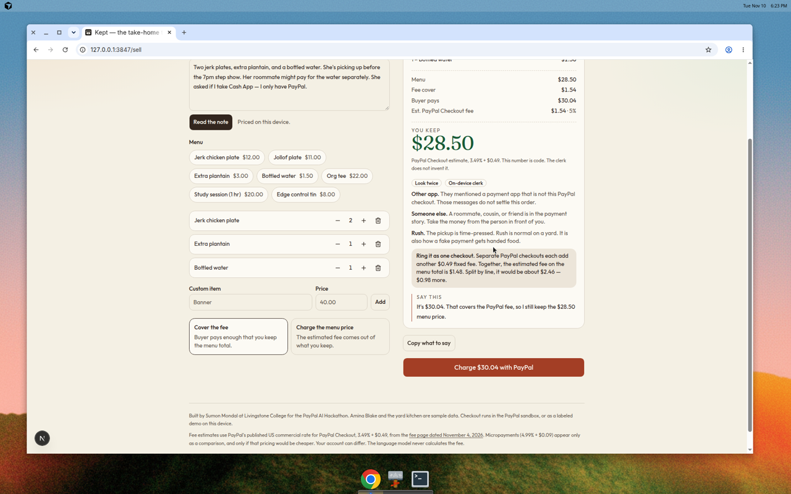
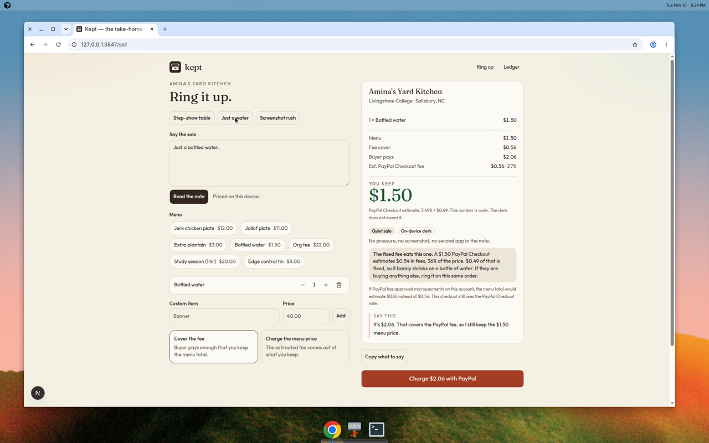
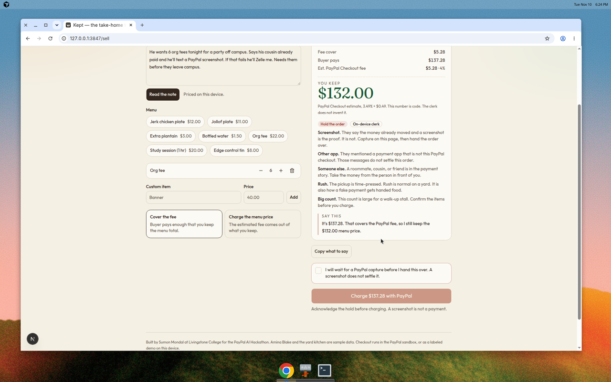
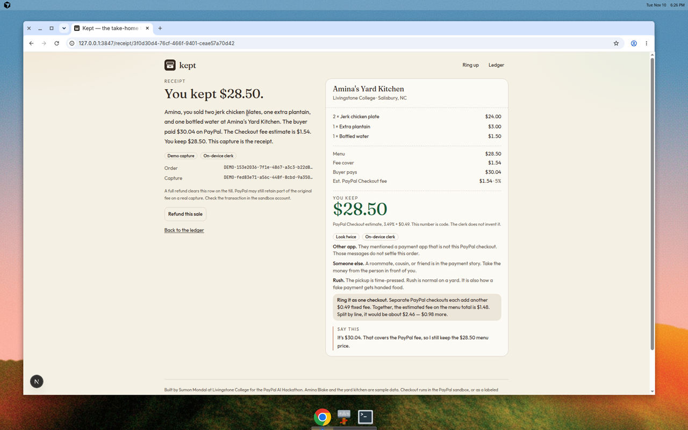

# Kept

A take-home till for campus sellers. Say the sale. See what you keep after PayPal Checkout. Do not hand over an order that arrives as a screenshot.

Built by **Sumon Mondal**, Computer Information Systems, Livingstone College (Salisbury, NC), for the PayPal AI Hackathon.

The sample stall is fictional: Amina Blake, Amina's Yard Kitchen, on the yard at Livingstone. Rename it from **Edit stall** if you want the demo in your own name.

## For judges

From a clean clone, in this order:

```bash
npm install
npm test
npm run dev
```

`npm run dev` listens on port **3847**. Open [http://127.0.0.1:3847](http://127.0.0.1:3847) (or [http://localhost:3847](http://localhost:3847)).

`npm test` runs the Vitest suite for the fee formula, the note parser, the risk holds, the PayPal purchase-unit math, and the rule that throws away model prose when the dollars do not match.

### Demo mode, no keys

Do not create a PayPal app or an AI key to try the product. With `.env` unset, checkout still completes. Captures are marked **Demo**, ids start with `DEMO-`, and the sale stays in this browser (`localStorage`). The fee math, the note parser, the hold rules, and the receipt all run.

### PayPal sandbox keys

1. Sign in at [developer.paypal.com](https://developer.paypal.com/dashboard/applications/sandbox) and create a sandbox app.
2. Copy the template and fill in that app’s Client ID and Secret:

```bash
cp .env.example .env.local
```

```
PAYPAL_CLIENT_ID=your_sandbox_client_id
PAYPAL_CLIENT_SECRET=your_sandbox_secret
```

3. In Sandbox Accounts, use a **personal** buyer to pay. The business account that owns the app receives.
4. Stop the dev server and run `npm run dev` again. Checkout shows the official PayPal button.
5. Kept calls `https://api-m.sandbox.paypal.com` only. A live key fails against that host on purpose. Do not commit `.env.local`.

The button creates an order (`POST /v2/checkout/orders`) and, after approval, captures it (`POST /v2/checkout/orders/{id}/capture`). The server recomputes the total from the menu and refuses a capture whose amount does not match. Refunds on a sandbox capture call `POST /v2/payments/captures/{id}/refund`.

If the sandbox call fails, the checkout page still offers **Capture a demo instead**, so a judging session does not die on a bad key.

### Optional language model

Any OpenAI-compatible chat completions API:

```
AI_API_KEY=...
AI_BASE_URL=https://api.openai.com/v1
AI_MODEL=gpt-4o-mini
```

A Groq account works with `AI_BASE_URL=https://api.groq.com/openai/v1`. After a restart, **Read the note** can show **Model clerk**. The model may correct items and rewrite the sentence the seller says. It is given the dollar strings after the code has already computed them. If its sentence does not contain those exact strings, Kept keeps the on-device sentence.

No key, no model call. The tape says **On-device clerk**.

## What you can click

- **Home.** Today's keep, against a goal. The $12 plate figure is computed from the same fee function as checkout.
- **Ring up.** Three notes are built in: Step-show table, Just a water, Screenshot rush. Or type your own, or tap the menu.
- **Cover the fee** makes the buyer pay enough that you keep the menu total. **Charge the menu price** lets the estimate come out of your pocket. The tape shows both.
- **Screenshot rush** stays disabled until you confirm you will wait for a capture.
- **Checkout.** PayPal sandbox, or a demo capture.
- **Receipt.** A short paragraph, the order id, and a refund.
- **Ledger.** Kept, not gross. Sample rows are labeled and can be cleared.

The ledger lives in this browser. Clearing site data clears it.

## What is real, and what is demo

| Piece | Without keys | With keys |
| --- | --- | --- |
| PayPal Checkout fee, 3.49% + $0.49, and the sticker that clears a menu total | Real code | Real code |
| Note → cart, risk holds, bundle warning | On-device parser and rules | Same rules. The model may correct items. Menu prices cannot be changed by the model. |
| Buyer line and receipt | Template that includes the computed dollars | Model prose only if it repeats those dollars |
| Create order, buyer approval, capture | Demo ids prefixed `DEMO-` | PayPal Orders v2 on sandbox |
| Refund | Demo or sample id, till updates locally | PayPal Payments v2 refund on sandbox |
| Sample evening | Labeled sample. Never sent to PayPal | Same |

Fee source: [PayPal US merchant fees](https://www.paypal.com/us/business/paypal-business-fees), commercial PayPal Checkout, fixed fee in USD, page dated November 4, 2026. Micropayments (4.99% + $0.09) are shown only as a comparison, and only when that schedule would be cheaper. The PayPal button on this page is Checkout, so the charge uses the Checkout rate. Your real fee can differ by account, country, and product.

A full refund zeros the row on this till. PayPal may still keep part of the original fee. The receipt says so.

## Screenshots











## Layout

- `app/` pages and route handlers
- `lib/money.ts` fee math
- `lib/parse.ts` note parser
- `lib/risk.ts` hold rules
- `lib/review.ts` tape, spoken line, receipt, charge gate
- `lib/paypal.ts` sandbox OAuth, create, capture, refund
- `lib/llm.ts` optional model call
- `components/` till UI, including the PayPal button

## Hackathon notes

Submission write-up: [DEVPOST.md](DEVPOST.md). Shot list for the YouTube video: [DEMO_SCRIPT.md](DEMO_SCRIPT.md).

Do not commit `.env.local`. The template is `.env.example`.
